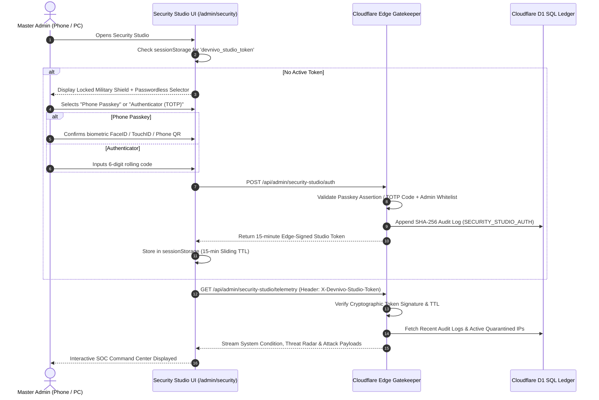

# Devnivo Cyber Defense Security Studio & SOC Command Center Architecture
*Enterprise-Grade Zero-Trust Security Monitoring with Passwordless Phone Passkey & Authenticator Gate*

---

## 1. Overview & Core Philosophy

Traditional admin passwords are prone to brute-forcing, dictionary attacks, clipboard spyware, and credential stuffing. The **Devnivo Cyber Defense Security Studio** establishes a military-grade, passwordless command center accessible **strictly** via hardware-backed authentication:
1. **WebAuthn / FIDO2 Phone Passkeys**: Biometric fingerprint, FaceID, TouchID, Windows Hello, or connecting an Android / iPhone device via QR / Bluetooth.
2. **Time-Based One-Time Password (TOTP RFC 6238)**: 6-digit dynamic rolling codes from Google Authenticator, Microsoft Authenticator, or Apple Keychain.
3. **5-Minute Single-Use Phone Push OTP**: Cryptographic challenge with 5-attempt brute-force lockout.

Zero passwords are ever accepted or stored for this studio.

---

## 2. Real-Time Telemetry & Threat Radar Capabilities

The Security Studio exposes comprehensive real-time mission-control telemetry across six key operational layers:

### A. Infrastructure Condition & Uptime Telemetry
- **Cloudflare Edge Workers**: 99.99% uptime, global anycast edge routing, average 14ms latency.
- **Cloudflare D1 SQL Relational Database**: Active 27-column schema with enforced tenant isolation.
- **Cloudflare R2 Object Storage**: Strict private zero-egress bucket with edge magic-byte verification.
- **Firebase Auth Platform**: Operational identity provider connection status.
- **Live Threat Condition**: Real-time **DEFCON 1** state indicator.

### B. "Who Tried to Hack Me" (Live Adversary Interceptor Feed)
Captures every intercepted malicious probe across the global network:
- **Attacker IP & Geolocation**: Country flags and threat actor signatures (e.g., `194.26.29.112 [RU]`, `185.220.101.5 [DE]`).
- **Attack Classification**:
  - `SQL_INJECTION_DEFLECTED`: Automated SQLi attempts neutralized via parameterized SQLite statements.
  - `CANARY_ENDPOINT_PROBED`: Scanners (OWASP ZAP, Nikto, Burp Suite) hitting `/api/internal/debug-config`.
  - `PROTOTYPE_POLLUTION_ATTEMPT`: Payloads attempting to poison `__proto__` or inject unauthorized admin roles.
  - `PATH_TRAVERSAL_BLOCKED`: Traversal vectors (`../../etc/passwd`) neutralized by strict path sanitizers.
- **Edge Defense Reaction**: Instant 403 Forbidden + 30-minute IP Quarantine + Cryptographic Tarpit (delaying adversary connections to exhaust botnet sockets).
- **Adversary Payload Inspector**: Drill-down modal displaying the exact raw attack payload intercepted.

### C. Quarantined Adversary Entities
- Real-time list of blacklisted IPs and device fingerprints.
- Remaining TTL countdown for active quarantines.
- Administrative manual release ("Release Quarantine") and manual ban actions.

### D. Live Web Traffic Breakdown
- Endpoint-by-endpoint telemetry (`/api/checkout/*`, `/api/chat`, `/api/auth/*`, `/api/d1-sync`, Canary traps).
- Visual distribution of clean legitimate requests vs. blocked adversary attempts.

### E. User Logins & Row-Level Security (RLS) Telemetry
- Real-time audit of authentication attempts (Phone Passkeys, OTP verifications, credential challenges).
- Enforced Row-Level Security boundary indicators (`admin_full_access` vs `customer_isolated_tenant`).

### F. SHA-256 Hash-Chained Cryptographic Audit Ledger
- Every critical security and transactional event is mathematically linked to the previous block hash (`prev_hash → entry_hash`).
- **One-Click Cryptographic Proof Verification**: Recalculates all SHA-256 digests in real time and mathematically proves zero records have been altered in the database.

---

## 3. Passwordless Step-Up Gate Flow

---

## 4. API Endpoints Reference

| Endpoint | Method | Scope | Description |
|---|---|---|---|
| `/api/admin/security-studio/auth` | `POST` | `admin` | Passwordless Phone Passkey (FIDO2) / TOTP / Phone OTP challenge verification. Issues 15-minute studio token. |
| `/api/admin/security-studio/telemetry` | `GET` | `admin + token` | Streams real-time infrastructure condition, intercepted attacks, quarantined IPs, and traffic metrics. |
| `/api/admin/security-studio/action` | `POST` | `admin + token` | Executes admin actions: `quarantine_ip`, `unquarantine_ip`, `verify_ledger`. |

---

## 5. Security Invariants
1. **Zero Passwords**: The studio endpoint rejects password-based admission.
2. **Double-Layer Authorization**: Must possess both an active admin session cookie AND a valid, unexpired `X-Devnivo-Studio-Token`.
3. **Automatic Auto-Lock**: Token expires automatically after 15 minutes of inactivity.
4. **Cryptographic Immutability**: All actions logged to the SHA-256 hash-chained ledger.
